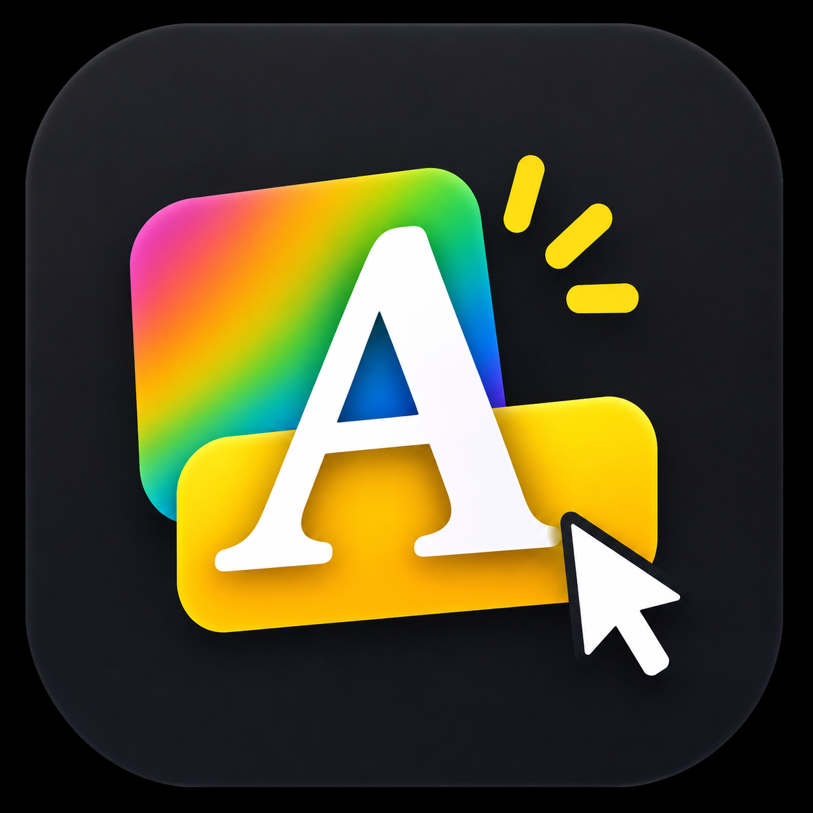

# Let It Colorful

[繁體中文](README.zh-TW.md)

Apply and remove text and background colors in Obsidian using inline HTML spans. No external CSS or network service is required.

## Installation

Copy `main.js` and `manifest.json` into your vault's `.obsidian/plugins/let-it-colorful/` directory. Enable Let It Colorful in Settings → Community plugins. Minimum configured Obsidian version: 1.15.1.

## Usage

Select text in editing mode and use the command palette, assigned hotkeys, or the desktop editor context menu. On mobile, add the commands to the mobile toolbar in Settings.

- Text color
- Highlight background
- Remove text color
- Remove background highlight
- Remove text and background color

Open Settings → Let It Colorful to customize the independent text and background palettes. Colors can be added, edited, reordered, removed or reset.

## Limitations and privacy

Use plain text or supported color spans; complex HTML and code are not supported. If a rendered selection cannot be mapped, try Source mode. Settings are stored locally using Obsidian's plugin data API. The plugin makes no network requests. The readable JavaScript source is `main.js`; no build step is required.

## Support and license

Report issues at https://github.com/catmanc/let-it-colorful/issues. MIT License. Copyright (c) 2026 jimmy C. Studio.
