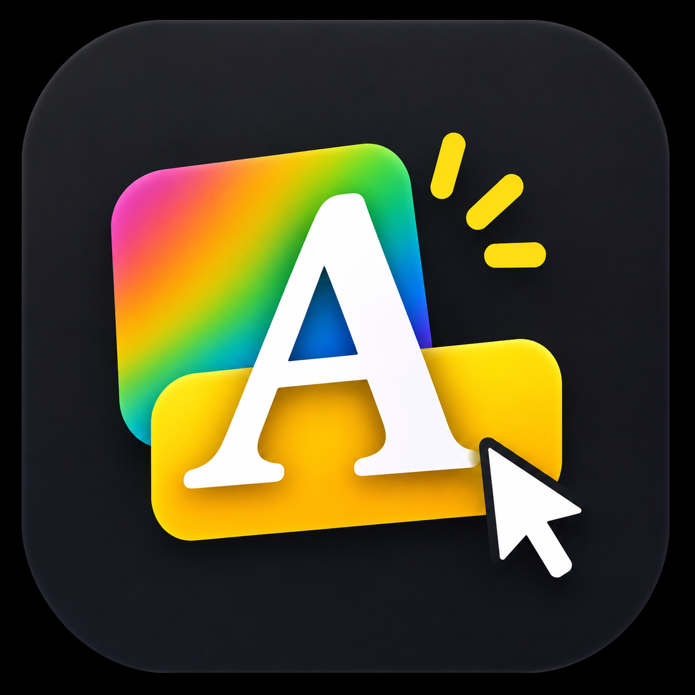

# Let It Colorful

[English](README.md)

使用原生 HTML span 設定及移除文字與背景顏色，不需要外部 CSS 或網路服務。

## 安裝

將 `main.js` 與 `manifest.json` 複製至 Vault 的 `.obsidian/plugins/let-it-colorful/`，在 Settings → Community plugins 啟用外掛。設定的最低 Obsidian 版本為 1.15.1。

## 使用方式

在編輯模式選取文字，使用 Command Palette、快捷鍵或桌面右鍵選單。行動裝置可將指令加入行動工具列。

- Text color：文字上色
- Highlight background：背景上色
- Remove text color：移除文字顏色
- Remove background highlight：移除背景顏色
- Remove text and background color：移除全部顏色

在 Settings → Let It Colorful 自訂獨立的文字及背景色票，可新增、修改、排序、刪除及恢復預設值。

## 限制及隱私

適用於純文字及支援的色彩 span，不支援複雜 HTML 或程式碼。若無法定位渲染後的選取範圍，請使用 Source mode。設定透過 Obsidian API 儲存在本機，外掛不進行網路連線。`main.js` 即為可閱讀的原始碼，不需建置。

## 問題回報與授權

https://github.com/catmanc/let-it-colorful/issues

MIT License。Copyright (c) 2026 jimmy C. Studio。
